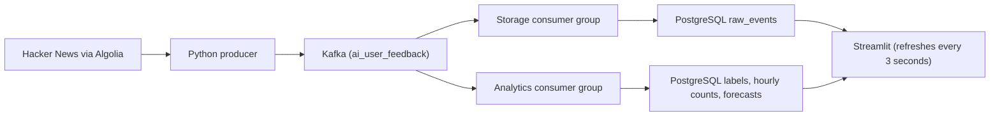
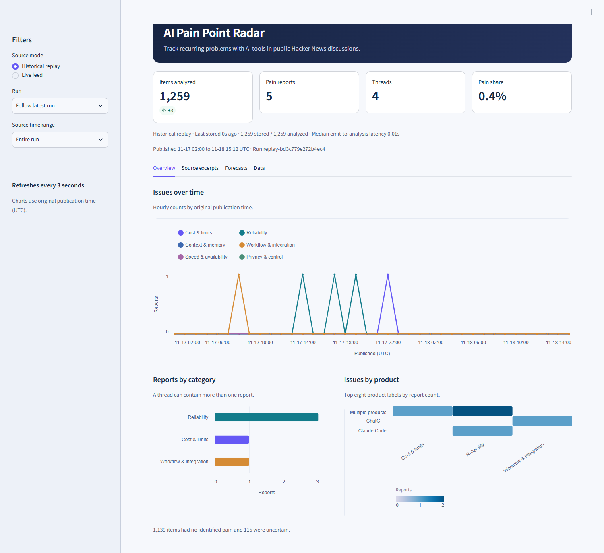
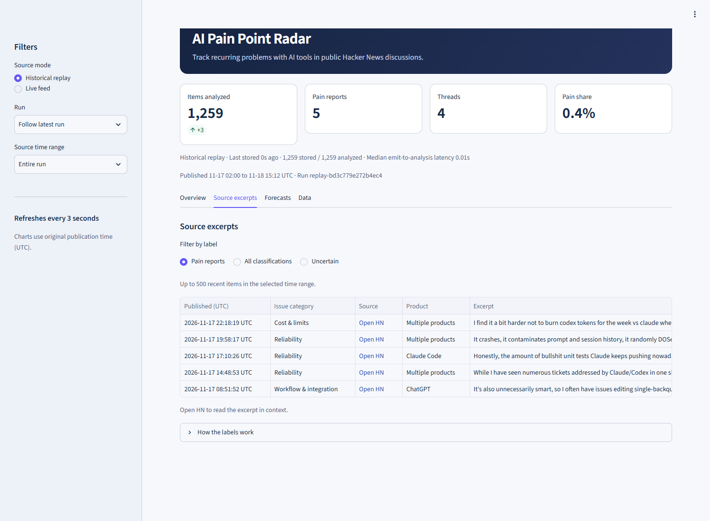
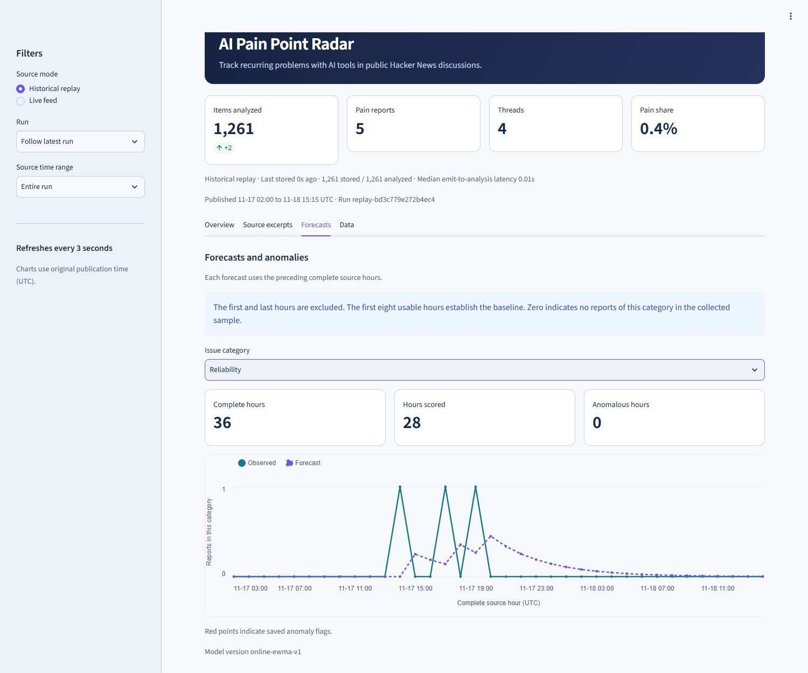
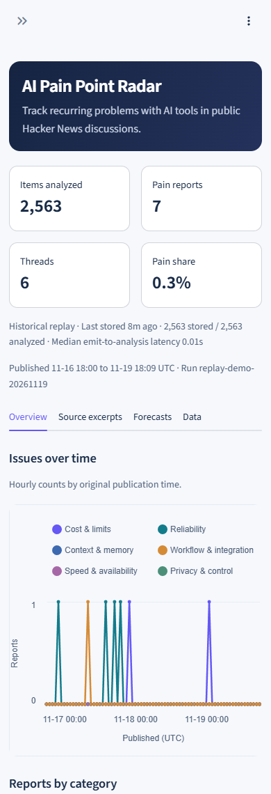

[](https://github.com/USERZEROA/AI_Pain_Point_Radar/actions/workflows/ci.yml)

# AI Pain Point Radar

[Open the live Streamlit dashboard](https://34.71.240.199)

Which problems do people report when they use AI tools? The radar groups first-person complaints by issue and links them back to the public discussions. The counts describe a keyword sample of posts and comments. [Hacker News search API](https://hn.algolia.com/api).

## Run it

Start Docker with Compose v2 and run these commands with Python 3 installed.

```bash
git clone https://github.com/USERZEROA/AI_Pain_Point_Radar.git
cd AI_Pain_Point_Radar
python scripts/start.py
```

Open [localhost:8501](http://localhost:8501). On first launch the producer downloads a recent batch from Hacker News and replays about one item per second. It preserves the original timestamps and starts a new run after each pass. Use `python scripts/start.py --mode live` and choose **Live feed** to follow new posts. Use `docker compose down` to stop. [Public deployment](docs/DEPLOYMENT.md).

## Pipeline



The Kafka key is `thread_id` so each story and its comments go to the same partition. Each event has 15 fields, including `event_id`, `source_created_at`, the `item_type` category, and numeric `text_length`. Consumers commit offsets after writing to PostgreSQL.

## Results

In a 330-second observation, raw and analyzed rows grew from **25 to 350** and hourly aggregates updated as events arrived. A complete replay analyzed **2,563** items and flagged **7** reports in **6** threads. [Stream check](evidence/stream-check.json) | [Source manifest](evidence/source-manifest.json) | [Hosted browser check](evidence/cloud-browser-check.json).

The analytics consumer saves an EWMA forecast for each category and complete source hour. Across 378 scored category-hours, forecast MAE was **0.0304** reports per hour versus **0.0317** for the previous-hour baseline. The replay had zero flagged anomalies. [Model evaluation](evidence/model-evaluation.json).

## Dashboard



Hourly counts, issue categories, and product breakdown from the recorded replay.

<details>
<summary>Source excerpts, forecasts, and mobile view</summary>



Source excerpts link each classification to the original discussion.



The forecast tab shows observed counts against the saved forecast.



The same replay on a phone-width screen.

</details>
